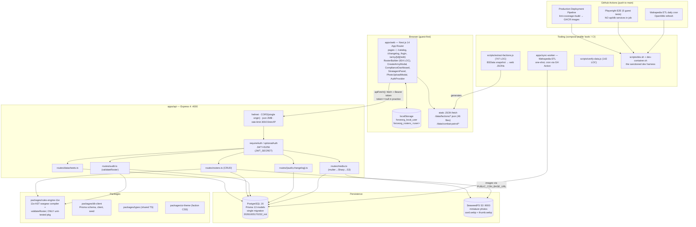

# BEERHAMMER-ARCHITECTURE — Architecture Pass + Candidate Work Packages

- Card: BH-ARCH (t_67618ae2) · Author: sw-architect · Date: 2026-10-08
- Upstream: https://github.com/fatpat81/BeerHammer — local clone `/local/projects/beerhammer` @ `36f00f2` == `origin/main` (**never push**)
- Prerequisite input: `specs/BEERHAMMER-CONTEXT.md` (BH-CTX, software-co @ 7a9b8ba) — read first; this doc goes deeper and does not repeat the punch-list table verbatim.
- Files read for this pass: root package.json/turbo.json, docker-compose{,.dev,.prod}.yml, scripts/{dev.sh,dev-container.sh,extract-factions.js,verify-data.js}, apps/api/src/** (index, middleware/auth, routes/{rosters,media,audit}, sizes for datasheets/changelog), apps/web/src/lib/{api.ts,supabase.ts}, apps/web/src/components/* (sizes), apps/web/e2e/critical-flows.spec.ts, packages/db-client/prisma/schema.prisma + migrations/20261005170232_init, .github/workflows/{deploy,e2e,wahapedia-sync,openwiki-update}.yml (sizes), AGENTS.md.

---

## 1. Component diagram



## 2. Request / data flows

### 2.1 Guest roster flow (the dominant runtime path)

```
user action (create/edit/delete roster)
  → api.ts createRoster/updateRoster/deleteRoster
  → apiFetch → fetch(`${NEXT_PUBLIC_API_URL}/rosters…`)
  → ALWAYS fails auth (see finding A1: token is always null → 401)
  → catch {} swallows
  → local optimistic state written to localStorage['forceorg_rosters_<user>']
  → UI renders from local state
```

The web app is effectively a **local-first app with a vestigial remote path**. Read
side is identical: `fetchRosters` tries the API, on any error falls back to
`getStoredRosters` (or the built-in DEFAULT_STARTER_ARMY). This is why the E2E
suite passes with no API/DB in the CI job — by design (BH-CTX §1 "transparent
fallback") and by necessity (the token can never exist, finding A1).

### 2.2 Catalog flow (static-data path — no API involved)

```
/catalog or army builder needs datasheets
  → fetch(`${basePath}/data/factions/<fid>.json`)   [public static export]
  → maps flat JSON into Datasheet[] shape (weapons scored 0 detachmentPointsCost)
  → on fetch failure → apiFetch('/datasheets')      [DB-backed path, rarely used]
  → on that failure → 3 hardcoded fallback Ultramarines datasheets
```

Five `factionId` aliases are hardcoded in `api.ts` L158-163 (adeptus_astartes →
imperium-space-marines etc.) — the mapping seam between DB faction keys and
extractor file names.

### 2.3 Write path that DOES work (only under JWT): API→DB

Authenticated clients (only test harnesses today — CDF: none in repo) call
POST/PUT/DELETE `/api/rosters`. PUT semantics at `rosters.ts` L108-114: guarded
fields (`?? existing.*`) preserved, unguarded fields (`detachmentSecondary`,
`factionThemeOverride`) set directly from body (explicit `null` clears them;
omitted → `undefined` → Prisma skips). Matches BH-CTX P3-refined.

### 2.4 Media upload flow

`POST /api/rosters/:rosterId/units/:unitInstanceId/media` (also aliased
`/media/upload`) → multer 10MB memory storage + mimetype allowlist → Sharp
processes card+thumb → S3 put under `buildStorageKeyPrefix()` →
`userUnitMedia` upsert (`@@unique([rosterId, unitInstanceId])`). Same
requireAuth gate ⇒ same A1 dead-end in the browser today.

### 2.5 Audit flow

`POST /api/rosters/:id/audit` → loads owned roster → `prisma.datasheet.findMany`
for units' datasheetIds → `@forceorg/rules-engine-11e validateRoster` →
discrepancy list. Web fallback (`api.ts auditRoster`) does a points-limit-only
check locally.

### 2.6 Data/ETL flow

```
pinned BSData snapshot data/bsdata/ (~47MB, committed)
  → scripts/extract-factions.js npm run data:extract
  → apps/web/public/data/factions/*.json (46 files: 27 factions + -library subfactions)
  + apps/web/public/data/combat-patrol/*
  → scripts/verify-data.js npm run data:verify (schema + counts)

wahapedia.ru (advisory cross-ref; BSData primary)
  → apps/sync-worker etl-pipeline → Prisma write (SyncMetadata tracking)
  → daily GH Action cron (DATABASE_URL via repo secret)
```

### 2.7 CI flow

- **deploy.yml** (push main/PR): `npm ci` → prisma generate → lint + rules-engine
  coverage → `npm run build` (turbo) → GHCR images. Note `postinstall` runs
  `prisma generate` too — fine in CI, causes the avoid-host-install Note N3.
- **e2e.yml**: build web, Playwright 5-test guest suite, artifacts 14 days.
- **wahapedia-sync.yml**: limited-workspace build (types/db-client/rules-engine
  only) then `worker:sync`.
- **openwiki-update.yml**: upstream-owned; failing 2× consecutively (581910f,
  36f00f2) — do NOT hand-edit `openwiki/` (AGENTS.md).

## 3. Architect's findings (new this pass, beyond BH-CTX)

- **A1 — The API write surface has no real client.** `apps/web/src/lib/api.ts
  getAuthToken()` is implemented ONLY via `createClient()`
  (`lib/supabase.ts`) which builds against `NEXT_PUBLIC_SUPABASE_URL ||
  'https://placeholder.supabase.co'` with an anon-key placeholder. Supabase was
  removed in the self-hosted migration (PR #1) but the auth TOKEN SOURCE was
  never replaced: `getSession()` will always fail/return null ⇒ every mutating
  `apiFetch` gets 401 ⇒ swallowed ⇒ localStorage. Consequence: **the entire
  authenticated API surface (roster CRUD, media upload, audit) is exercised by
  no client and no CI.** All QA findings on write routes (P2-new 500s, P3 PUT
  semantics) came from manual curl. This is the single biggest gap between the
  architecture-as-drawn and as-run.
- **A2 — No server-side input validation layer exists.** No zod/joi/express-
  validator anywhere; every route trusts `req.body`/params shape, every DB
  error is flattened to 500 `DB_ERROR` (catch-all per route, plus a global
  500-only error handler in index.ts — no Prisma-error taxonomy).
- **A3 — `scripts/dev.sh rebuild` references a nonexistent compose service.**
  `docker compose build --no-cache deps` — `docker-compose.dev.yml` has no
  `deps` service (services: postgres, s3, db-init, web, api, toolchain). The
  command dies with "no such service: deps"; the intended target is the
  `x-dev-image` build. Genuine upstream defect (fresh addition to inventory).
- **A4 — Prisma schema integrity risk: all UUID PKs are app-generated.**
  Every model id is `@default(uuid())` (no DB default in the single migration,
  `20261005170232_init`). QA P2-new ("non-UUID id → P2023 → 500") is the
  visible symptom; the boundary guard belongs at the route layer (A2-defect).
  Do not "fix" this in the schema — a default change would require a second
  migration and re-seed; the route-level fix is cheaper and reversible.
- **A5 — `sync-worker` source lives at `apps/sync-worker/apps/sync-worker/src`**
  (nested double path), i.e. the worker imports itself as a workspace while its
  sources sit one level deeper. Cosmetic-but-dangerous: refactor tools and
  people "fixing" the nesting will break the GH Action build steps that cd into
  the repo-root-relative paths. Forbidden zone until upstream weighs in.
- **A6 — Test asymmetry.** 53 vitest tests exist, all in rules-engine
  (`npm test` = `turbo run test`; only rules-engine has a test script).
  apps/api has zero tests despite being the "only integration surface"
  (README). No test-db harness pattern exists to copy — WP-1 must establish one.
- **A7 — Dual datasheet provenance.** Consumers see three datasheet shapes:
  static JSON (extractor output, `detachmentPointsCost: 0`, synthetic ids),
  DB rows (prisma), and the 3 hardcoded offline fallbacks. Any consumer-facing
  change must hold all three consistent or degrade explicitly — treat
  `api.ts fetchDatasheets` mapping as a contract.
- **A8 — Error envelope contract is stable and worth protecting.**
  `{ success: boolean, data?, error?: { code, message } }` is used consistently
  across routes and `ApiError` in api.ts keys off `error.code`. Hardening work
  must extend the `code` vocabulary, never reshape the envelope.

## 4. Extension points — where our dev work lands

| Extension point | Location | What lands there |
|---|---|---|
| Route-level validation middleware | new `apps/api/src/middleware/validate.ts` (or `lib/`) | UUID param guard, body-shape guards (WP-1) |
| Prisma error → HTTP mapping | new `apps/api/src/lib/error-map.ts` + route catch blocks | P2023→400, P2025→404, FK/P2003→400, rest→500 (WP-1) |
| API unit/integration tests | new `apps/api/tests/` + vitest, `apps/api/package.json` `test` script | supertest handlers with `vi.mock('@forceorg/db-client')` (WP-1 establishes the pattern BH-CTX A6 lacks) |
| Dev harness bootstrap | `scripts/dev-container.sh` `api`/`web` cases, `scripts/dev.sh up/rebuild`, `docker-compose.dev.yml` healthcheck blocks | first-boot dependency build, HTTP healthchecks, rebuild target fix (WP-2) |
| Data verification | `scripts/verify-data.js`, `scripts/extract-factions.js` | catalog verification pass + extractor fixes (WP-3) |
| Error envelope codes | `apps/api/src/routes/*.ts`, consumed by `apps/web/src/lib/api.ts` ApiError | new codes: `VALIDATION_ERROR`, `NOT_FOUND` reuse (A8 shape frozen) |

## 5. Risk list — what breaks if you touch X

| Touch X | Breakage mode | Severity |
|---|---|---|
| `packages/db-client/prisma/schema.prisma` | One migration exists; any change needs migration #2 + re-seed of every env (dev + QA standing stack on ga01). `postinstall` prisma-generate makes host npm install require network (P4 EBADENGINE Streisand). | HIGH — avoid schema changes in WPs 1-3 |
| `apps/web/public/data/**` (hand-edits) | Generated output; verified by verify-data.js; hand edits get clobbered by next `data:extract`. NEVER hand-edit (AGENTS-adjacent rule, BH-CTX §5). | HIGH |
| `openwiki/` + `.github/workflows/openwiki-update.yml` | Already failing upstream 2×; AGENTS.md forbids hand-editing generated pages. Any change invites upstream conflicts + we can't verify locally. | HIGH (forbidden) |
| `apps/api/src/middleware/auth.ts` JWT fallback | Dev/E2E legs mint tokens against `dev-secret-change-in-production`; changing default breaks QA's token-mint procedure. | MED |
| `scripts/dev-container.sh` / `docker-compose.dev.yml` (WP-2 files) | Everyone's dev loop + QA standing stack share the `forceorg-dev` compose project on ga01. `down -v` kills the standing env (operator-visible). Healthcheck additions change `up -d` attach behavior (compose waits on healthy). | MED — test in `-p forceorg-wp2` side project |
| `apps/web/src/lib/api.ts` | Single seam for all 3 datasheet shapes (A7) + localStorage keys. Fallbacks are what E2E green depends on; "cleaning up" the weird null-token call path without design would silently kill guest persistence. | MED |
| Rate-limit 300/15min/IP | Load-bearing for the 27-file static-catalog page; loosening invites upstream prod incidents. | LOW (don't touch) |
| `apps/sync-worker/apps/sync-worker/src` nesting (A5) | Refactor breaks GH Action build steps; non-hermetic (network ETL) = untestable locally. | Do not touch |
| `apps/api/src/services/*` (Sharp pipeline) | Native dep (sharp) in container; version bumps need image rebuild. | LOW-MED |
| Error envelope shape (A8) | Reshaping breaks every api.ts caller + QA smoke expectations. | Extend codes only |

## 6. Candidate work packages for sw-dev-a / sw-deb-b

All work happens on **fork-local branches in `/local/projects/beerhammer`** (never
push; no upstream PRs without operator GO). Every WP ends with
`./scripts/dev.sh verify` green in-container; QA smoke where relevant.

### WP-1 — API input-hardening + honest error contract (sw-dev-a; LANE-A)

Aligned to punch-list P2-new, P7, P3-refined. Best first PR: small, test-backed,
zero UI impact.

- **Goal**: `/api/rosters/:id*` (rosters.ts incl. audit in audit.ts, media.ts)
  returns 400 `VALIDATION_ERROR` for non-UUID ids; Prisma known errors map to
  correct statuses (P2023→400, P2025→404, P2003 FK→400, else 500 with
  `DB_ERROR`); PUT passes only provided keys to `prisma.update` (conditional
  spread) so explicit-null vs omitted semantics are intentional and documented
  in a doc-comment; establishes the API test pattern (supertest + mocked
  PrismaClient, vitest).
- **Files likely touched**: `apps/api/src/routes/rosters.ts`, `audit.ts`,
  `media.ts`; NEW `apps/api/src/middleware/validate-id.ts` (or coordinator
  decides lib/ vs middleware/ — pick once, document in the diff),
  NEW `apps/api/src/lib/prisma-error-map.ts`, NEW `apps/api/tests/*.test.ts` +
  vitest config; `apps/api/package.json` (+`test` script run by turbo).
- **Interfaces/schemas to conform to**: error envelope `{success, error:{code,
  message}}` (A8 — shape frozen, codes extended only); Prisma error codes per
  Prisma 5 docs; `@forceorg/types` ApiResponse.
- **Acceptance criteria**:
  1. `curl -X PUT .../api/rosters/not-a-uuid` (also GET/DELETE, audit, media)
     → 400 `{VALIDATION_ERROR}` — never 500/`DB_ERROR`.
  2. PUT omitting `detachmentSecondary` preserves it; explicit `null` clears it
     — both asserted by tests (P3-refined codified).
  3. New API test suite ≥ 90% line coverage of rosters.ts; `npm test` green
     repo-wide (turbo now runs api + rules-engine suites).
  4. Existing QA smoke curl matrix re-passed against updated local branch
     (mint JWT with dev secret, per BH-CTX §5).
- **Risk**: LOW. Error-`code` strings are the only external contract; web client
  ignores codes it doesn't know (soft-fail). DB never touched → no migration.
- **Forbidden zones**: schema.prisma; auth.ts; rate limits; `apps/web/**`;
  docs/API.md prose (that spec predates the route behavior — real-diff any doc
  claims).
- **Non-goals**: no zod-everywhere refactor; no auth/session changes; no
  restructuring routes.

### WP-2 — Dev-env truthfulness: self-sufficient first boot + real health (sw-dev-b; LANE-B)

Aligned to punch-list P0 (upstream fresh-clone wall), P1 (false-green Up) —
upstream-report candidates #1–#2 — plus new finding A3 (`rebuild` broken).

- **Goal**: on a fresh clone with no prior build, `./scripts/dev.sh up` converges
  to a genuinely healthy stack unattended: api boots after workspace packages
  are built (first-boot build in `dev-container.sh` api case, cached by the
  `dev_turbo_cache` volume); `docker-compose.dev.yml` gains HTTP healthchecks
  for api (`wget -q /api/health` equivalent) and web (`GET /`), so
  `docker ps`/`depends_on` reflect reality, not docker-proxy liveness; `dev.sh
  rebuild` points at a real service target (fix A3); seaweedfs dev image pinned
  (P4 hygiene, same file).
- **Files likely touched**: `scripts/dev-container.sh` (api + web cases),
  `scripts/dev.sh` (rebuild case; up health messaging), `docker-compose.dev.yml`
  (healthcheck blocks; seaweedfs tag), optionally `docs/DEV_ENVIRONMENT.md`.
- **Interfaces to conform to**: `x-cmd`-image base has no wget guaranteed —
  Node-based healthcheck (`node -e` fetch) to avoid surprise missing binaries;
  compose v2 healthcheck syntax as used by the existing postgres block; the
  documented dev.sh verbatim API surface (up|down|rebuild|verify|test|e2e-
  install|e2e|logs|shell|psql — commands must keep working).
- **Acceptance criteria**:
  1. `docker compose -p forceorg-wp2 down -v` (or fresh checkout) →
     `./scripts/dev.sh up` → `curl :14000/api/health` 200 with **zero manual
     steps**, including the first boot on an empty `dev_node_modules` volume
     after `npm ci` linked-but-didn't-build (reproduces and eliminates P0).
  2. Killing the api process inside the container makes `docker ps` report
     unhealthy within the check interval (P1 dead).
  3. `./scripts/dev.sh rebuild` completes with exit 0 (A3 dead).
  4. Full `verify` + `e2e` unbroken; hot reload still works (host edit → container reload).
- **Risk**: MEDIUM — touches everyone's boot path. Mitigations: build step only
  when `packages/db-client/dist` missing (idempotent, opt-out via env), and do
  all destructive lifecycle testing in a **side compose project name**
  (`-p forceorg-wp2`) so the standing `forceorg-dev` stack at ga01:13000/14000
  survives (it's the operator's standing env — coordinate teardown separately).
- **Forbidden zones**: `docker-compose.yml`, `docker-compose.prod.yml`,
  `Dockerfile.*` (used by deploy.yml → GHCR path; out of scope),
  `apps/**` application code.
- **Non-goals**: no changing the toolchain image/Node version, no compose file
  re-architecture, no prod-compose parity work.

### WP-3 — Catalog/data verification pass (sw-dev-a or sw-dev-b; LANE-D)

Aligned to punch-list watch items (ETL flakiness, weapon-characteristic fix
lineage `caadd66`) and Battle Mode's dependence on catalog correctness.

- **Goal**: systematic `npm run data:verify` across all 46 static faction
  JSONs + Combat Patrol extractions on the CURRENT snapshot; reconcile:
  weapon characteristics gaps (stats/points consistency with BSData source),
  detachment costs (web mapping currently zeroes `detachmentPointsCost` in
  api.ts — confirm intentional vs. lossy for Battle Mode DP math),
  faction-key aliases api.ts L158-163 (are they complete? any new faction hits
  the DB-name/file-name mismatch); document findings; fix extractor bugs in
  `scripts/extract-factions.js`/`verify-data.js` only, regenerate outputs via
  `data:extract` (never hand-edit).
- **Files likely touched**: `scripts/verify-data.js` (expand assertions),
  `scripts/extract-factions.js` (if defects found), regenerated
  `apps/web/public/data/**` (via extract only), findings appended to this doc
  or a QA-report addendum.
- **Acceptance criteria**:
  1. `data:verify` green on all 46 faction files + combat patrols, with
     per-file record counts recorded in the report.
  2. Every gap found is either fixed-by-extractor or written up with the exact
     JSON path + source-of-truth citation. No silent skips.
  3. Regenerated output passes `data:verify` and the E2E catalog test
     (Terminator search) unchanged.
- **Risk**: LOW-MED — hermetic (no network, pinned snapshot), but
  `public/data/**` is user-visible surface; regen diffs can be large — keep the
  extractor diff and the data diff in separate commits.
- **Forbidden zones**: hand-edited `public/data/**` output, `data/bsdata/**`
  snapshot itself (pinned), `apps/sync-worker/**`.
- **Non-goals**: no BSData snapshot bump, no schema narrative rewrite.

### Ordering / dependencies

WP-3 is independent (start immediately, either dev). WP-1 and WP-2 are
independent of each other (API code vs harness/compose) but share the
`./scripts/dev.sh verify` gate — serialize QA smoke runs on the shared ga01
box if both land the same day. WP-2's P0-repro step will initially fail on
purpose — coordinate with QA so a red smoke isn't misread as a regression.

### Deferred (candidate inventory, NOT packaged — needs owner/PM call)

- **Auth token source replacement** (kills A1): a minimal session-mint endpoint +
  supabase.ts EOL, or accept local-only forever. Design-worthy; changes the
  security posture of /api writes — architect ADR required before any card.
- **Upstream report pack** (LANE-C, no code): P0/P1/P2-favicon/P3+P2-new + A3 —
  perfect report granularity now that A3 is found; PM + operator GO gate.
- Favicon 404 (fold into any web PR), OpenWiki workflow failure (upstream),
  LICENSE/Pages questions (owner).

## 7. Non-goals of this document

- No product-code changes (this pass is docs/consultation only).
- No work on the standing ga01 environment, no compose lifecycle executed.
- No upstream communication (issue drafts live in the report pack, LANE-C).
- No sync-worker refactor (A5 noted as forbidden; upstream-owned).
- No data snapshot bump or 11e rules interpretation — catalog fidelity only as
  far as the pinned snapshot's own consistency.

## 8. Revisit triggers (what falsifies these decisions)

- **Revisit WP-1 shape if** a schema change lands upstream that adds
  DB-default UUIDs (A4) — the route guard stays valuable but the error-mapping
  test matrix changes.
- **Revisit WP-2 approach if** upstream restructures dev compose (e.g. adds the
  missing `deps` service itself) — conflict risk in the same files is high;
  rebase-before-design.
- **Revisit the "API write surface is dead code" framing (A1) if** any UI path
  minting a real token appears upstream; then the local-first analysis and the
  risk table row for auth.ts both need rework.
- **Revisit deferred-item list if** operator GO arrives for upstream reports —
  report pack becomes a real card and A3 joins candidates #1-#4.
- **Revisit all of §5** after any upstream `feat(battle-mode)` commit: those
  touch RosterBuilder/api.ts naming and are the most-concurrently-moving files.

---
*Handoff: arch_doc = specs/BEERHAMMER-ARCHITECTURE.md (this file, software-co commit below); work_packages = WP-1 (API hardening, sw-dev-a), WP-2 (dev-env truthfulness, sw-dev-b), WP-3 (catalog verification, either). New defect found: A3 dev.sh rebuild → nonexistent 'deps' service. New critical finding: A1 — API write surface unreachable from all clients.*
